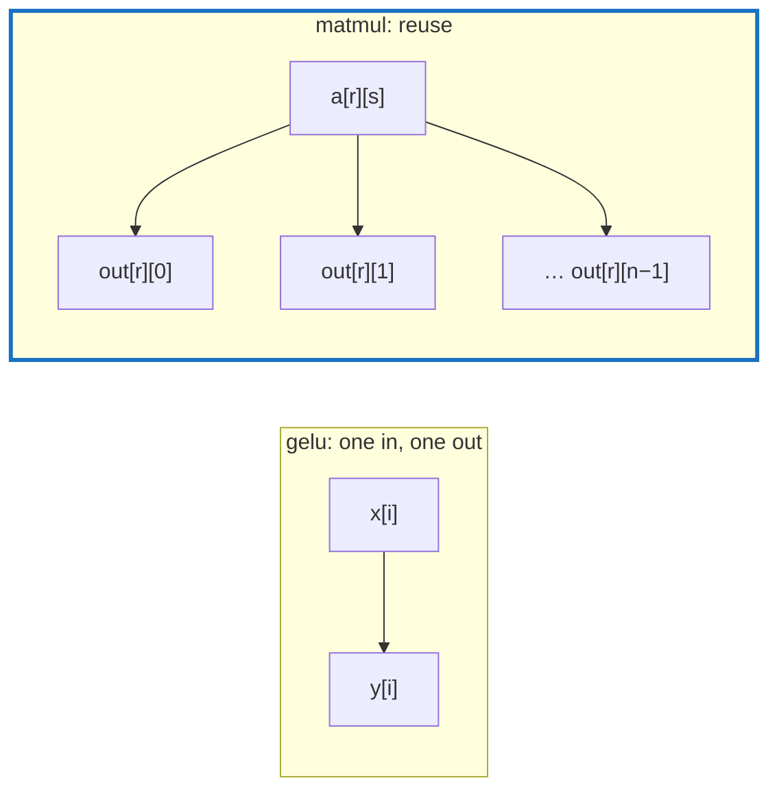

# Q-E: Why is matmul usually not fused like elementwise ops?

*[Fusion and kernels](README.md#fusion-and-kernels) · previous: [Q-D](q-d-spir-v-writer.md) · next: [Q-F](q-f-epilogue-fusion.md)*

## The question

Fusing elementwise ops reads the input once, does every step in registers, and writes the result once. Matmul is usually not fused this way. In matmul each output element reads a whole row of one matrix and a whole column of the other. What does that do to the "read once, compute in registers" trick?

> **Hint:** count how many outputs each input element contributes to, for an elementwise op and for a matmul.

<strong>Answer</strong>

### In short

In an elementwise op each input feeds one output, so a thread can read its element, do every step, and write. In a matmul `[m, k] · [k, n]`, each element of the first matrix feeds `n` outputs and each element of the second feeds `m`. The art of a fast matmul is reusing inputs: loading tiles into fast on-chip memory and using each value many times. That tiling dominates the kernel, so there is no simple per-element loop to merge other ops into. What can be fused is the edges: work on each output just before it is written (an epilogue), or on each input as it is loaded (a prologue).

It is not about shapes matching: a reduction changes shape and still fuses well.

### An analogy

A chef who fetches each ingredient once and cooks at the bench (elementwise), against a baker making a hundred cakes from shared bowls of batter: the work is organised around the bowls, which are used again and again. You can still ice each cake as it comes out, but you cannot fold the icing into the batter bowls.

### Worked example

Op                        |Inputs per output   |Outputs per input|Fuses as                                                          
--------------------------|--------------------|-----------------|------------------------------------------------------------------
`gelu` on `[1024, 3072]`  |1                   |1                |one kernel: about 25 MB of traffic instead of about 200 MB unfused
`sum` along a row         |the row             |1                |one kernel per row                                                
`[2048, 192] · [192, 768]`|192 from each matrix|768 or 2,048     |tiles; only the edges fuse                                        

### Where it shows up in tensomite

`gelu` is one fused kernel, `Kernels::GELU`, generated by `Tensomite.kernel`. The matmul kernels are tiled by hand (`Tiled`, `TiledTwoPass`), and since Decision BF they carry one epilogue: a contiguous bias added to each output before it is written.

## See also

- [Q-F](q-f-epilogue-fusion.md): which of GPT-2's ops can ride along at the end of a matmul.
- [Q-X](README.md#themes-to-come): why tiles cut reads, in the GPU speed theme.
