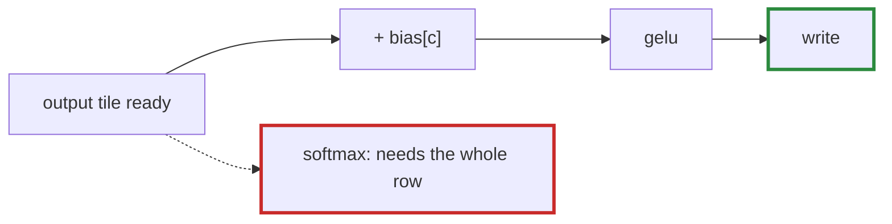

# Q-F: Which of GPT-2's ops could ride along at the end of a matmul?

*[Fusion and kernels](README.md#fusion-and-kernels) · previous: [Q-E](q-e-matmul-fusion.md) · next: [Q-G](q-g-online-softmax.md)*

## The question

A matmul can finish each output with extra work just before writing it: epilogue fusion ([Q-E](q-e-matmul-fusion.md)). Of GPT-2's ops (bias add, GELU, `exp`, `log`, `tanh`, the residual add, the causal mask, softmax, layernorm, the embedding lookup, writing into the KV cache), which could ride along at the end of a matmul, and which could not?

> **Hint:** when an output tile is ready, a thread knows its own element and its row and column. What does each op need besides that?

<strong>Answer</strong>

### In short

An op can ride along if each output needs only its own element, plus at most something at the same position or index. Bias add, GELU, `exp`, `log`, `tanh`, the residual add (one more tensor at the same position), the causal mask (needs only the row and column numbers) and writing into the KV cache (a different place to write) all qualify. Softmax and layernorm cannot: each output needs a statistic over its whole row, and a matmul tile holds only part of a row. The embedding lookup comes before any matmul, so there is nothing to ride along with.

### An analogy

Icing cakes as they leave the oven works when each cake is iced on its own. Grading cakes against the batch's average cannot be done until the whole batch is out.

### Worked example

One output, `out[r][c]`, of `x · W` in an MLP, as the tile finishes:

Op                     |What it needs besides `out[r][c]`|Rides along?                 
-----------------------|---------------------------------|-----------------------------
`+ bias`               |`bias[c]`                        |yes                          
`gelu`                 |nothing                          |yes                          
`+ residual`           |`residual[r][c]`                 |yes                          
causal mask            |`r` and `c`                      |yes                          
write into the KV cache|where to write                   |yes                          
softmax, layernorm     |the whole row `out[r][*]`        |no: other tiles hold the rest
embedding lookup       |comes before the matmul          |no                           

### Where it shows up in tensomite

Decision BF made the first of these real: `matmul(b, bias)` with a contiguous `[N]` bias adds `bias[col]` to each output in every matmul kernel, with the bits of a separate `Add`, and GPT-2 lost 48 `Add`s a token. Softmax and layernorm are fused instead as row ops, one kernel per row (Decision T).

## See also

- [Q-G](q-g-online-softmax.md): how FlashAttention fuses softmax into a matmul anyway.
