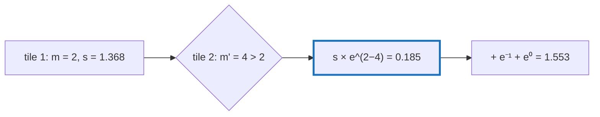

# Q-G: How can softmax be computed a tile at a time?

*[Fusion and kernels](README.md#fusion-and-kernels) · previous: [Q-F](q-f-epilogue-fusion.md) · next: [Q-T](q-t-softmax-two-passes.md)*

## The question

Softmax needs its row's maximum before it can start summing: `exp(xᵢ − m) / Σ exp(xⱼ − m)`. That is why it cannot ride along at the end of a matmul ([Q-F](q-f-epilogue-fusion.md)). FlashAttention fuses it into the attention matmul anyway. Suppose you have summed `exp(x − m)` with a running maximum `m`, and a later tile reveals a bigger maximum `m'`. What could you multiply the partial sum by to correct it?

> **Hint:** write `exp(x − m')` in terms of `exp(x − m)`.

<strong>Answer</strong>

### In short

`exp(x − m') = exp(x − m) · exp(m − m')`. So when the maximum grows from `m` to `m'`, multiply the running sum by `exp(m − m')` and carry on; the old elements never need revisiting. Subtracting the maximum at all is for safety: `exp(1000)` overflows, but every `exp(x − m)` is at most 1, and the shift cancels between top and bottom.

### An analogy

Totting up receipts in one currency when the currency is redenominated halfway. You do not recount every receipt; you convert the running balance once at the new rate and keep going.

### Worked example

The row `[1, 2 | 3, 4]`, in two tiles:

Step                                 |Maximum|Running sum                          
-------------------------------------|-------|-------------------------------------
tile 1: `e^(1−2) + e^(2−2)`          |2      |`0.368 + 1 = 1.368`                  
tile 2 brings 4: rescale by `e^(2−4)`|4      |`1.368 × 0.135 = 0.185`              
add tile 2: `e^(3−4) + e^(4−4)`      |4      |`0.185 + 1.368 = 1.553`              
check: `e⁻³ + e⁻² + e⁻¹ + e⁰`        |       |`0.050 + 0.135 + 0.368 + 1 = 1.553` ✓

### Why it matters for attention

Attention is `softmax(QKᵀ) · V`. FlashAttention keeps a running weighted sum of `V`'s rows next to `s`, and rescales both by the same factor, so the score matrix is never written to memory. For GPT-2 at 1,024 tokens and 12 heads that is about 12 million floats, roughly 50 MB a layer, that never leave the chip, for three extra multiplies per tile.

### Where it shows up in tensomite

Not yet: tensomite's attention computes the scores, then a fused softmax row op, then the second matmul. Online softmax is the route to fusing attention later. The tile order's effect on the last bits is [Q-H](q-h-tile-order.md).

## See also

- [Q-H](q-h-tile-order.md): the same example with the tiles reversed.
- [Q-T](q-t-softmax-two-passes.md): how the row op keeps the composite's bits.
