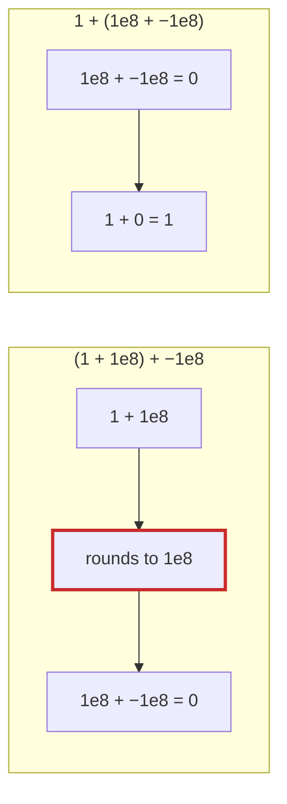

# Q-H: Does the order of tiles matter to online softmax?

*[Order of addition and determinism](README.md#order-of-addition-and-determinism) · first in the theme · next: [Q-AG](q-ag-fused-multiply-add.md)*

## The question

Online softmax sums `exp(x − m)` over a row a tile at a time, keeping a running maximum `m`. When a later tile brings a bigger maximum `m'`, it rescales the sum so far by `exp(m − m')` (see [Q-G](q-g-online-softmax.md)). For the row `[1, 2 | 3, 4]`, in two tiles, the sum comes to 1.553.

Redo it with the tiles in the other order, `[4, 3 | 2, 1]`. Does the rescaling step change anything? What does that tell you about whether the order of tiles matters, and why might the last digits still differ on a real GPU?

> **Hint:** follow the running maximum through both orders. Then ask what a computer does that paper does not.

<details>
<summary><strong>Answer</strong></summary>

### In short

With the largest value first, the maximum never grows, so nothing is ever rescaled; the sum is still 1.553. In exact arithmetic the order of tiles does not matter. In float32 it changes the last bits, because every addition and multiplication rounds, and a different order rounds different intermediate values.

### An analogy

A cashier who rounds to the cent after every line of a bill. Ring up the same items in another order and the total can differ by a cent, though nobody made a mistake.

### Worked example

Tiles                 |Tile 1                         |Tile 2                                                 |Sum  
----------------------|-------------------------------|-------------------------------------------------------|-----
`[1, 2]` then `[3, 4]`|`m = 2`, `s = e⁻¹ + e⁰ = 1.368`|`m' = 4`: rescale `1.368 × e⁻² = 0.185`, add `e⁻¹ + e⁰`|1.553
`[4, 3]` then `[2, 1]`|`m = 4`, `s = e⁰ + e⁻¹ = 1.368`|`m' = 4`: factor `e⁰ = 1`, add `e⁻² + e⁻³ = 0.185`     |1.553

To three decimals the two agree. In float32 the first order computes `e⁻¹ + e⁰`, then multiplies by a rounded `e⁻²`, then adds; the second adds the small terms last and never multiplies. Each step rounds, so the two results can differ in the last bit or two.

The smallest case of the same effect, which the rest of this theme reuses: three float32 numbers.

```
(1 + 1e8) + −1e8  =  0     1 + 1e8 rounds back to 1e8: float32 cannot hold 100000001
1 + (1e8 + −1e8)  =  1
```

Same numbers, different grouping, different answer. Floating-point addition is not associative.



### Where it shows up in tensomite

The precision of the type sets how big the error can be; the order of operations decides whether two runs land on the same bits. That is why Decision K talks about the order of additions, not only about precision: any kernel that wants matching bits must fix its order.

</details>

## See also

- [Q-AG](q-ag-fused-multiply-add.md): the same effect from one fewer rounding.
- [Q-AR](q-ar-splitting-a-sum.md): the three numbers again, in a GPU kernel.
