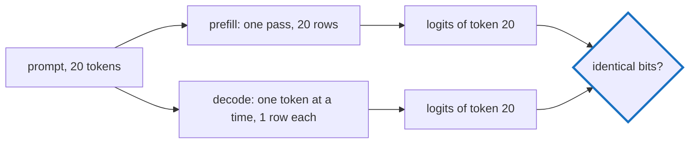

# Q-I: Why test prefill against decode exactly, not with a tolerance?

*[Order of addition and determinism](README.md#order-of-addition-and-determinism) · previous: [Q-S](q-s-fused-gelu.md) · next: [Q-R](q-r-split-depends-on-k.md)*

## The question

Decision K's level 2 promises that a token's logits do not depend on how the prompt was processed: computed in one pass over the whole prompt (prefill), or a token at a time with a KV cache (decode), the same position gives the same logits. The test for it compares the two exactly. Why exact equality, when the plan uses tolerances everywhere else?

> **Hint:** the tolerances elsewhere compare two different devices. What differs between prefill and decode, and what does not?

<strong>Answer</strong>

### In short

Tolerances cover differences we accept: another device, another maths library ([Q-S](q-s-fused-gelu.md)). Prefill and decode run on the same device, with the same kernels, and the promise is that they add in the same order. If they do, the bits are identical; if they are not, the promise is broken. A tolerance would pass a broken promise.

There is a practical reason too. A cached answer must be indistinguishable from a recomputed one, or a cache hit changes what the model says. Decoding feeds each token back in, so one last-bit difference that flips a near-tie at token 40 changes token 41, and the rest of the text diverges.

### An analogy

A tolerance is right for two shops' tills, which may round differently. It is wrong for the same till checking the same receipt twice: if those disagree by a cent, the till is broken.

### Worked example

Take the running example from [Q-H](q-h-tile-order.md). Suppose some output adds `1`, `1e8` and `−1e8`.
- Prefill groups them as `(1 + 1e8) + −1e8` and gets `0`.
- A decode that grouped them as `1 + (1e8 + −1e8)` would get `1`.

With a tolerance of, say, `1e-5` relative to the values involved, `0` and `1` against a scale of `1e8` would pass. Exact comparison catches the regrouping.

### Where it shows up in tensomite

`spec/metal_spec.cr` and `spec/cuda_spec.cr` each have "gives a tiled prefill the bits of a decode", which runs the tiny GPT-2 model both ways and compares with `==`. `bench/gpt2_digest.cr` prints a hash of the logits on every device, so a change that alters any bit shows up as a different digest.

## See also

- [Q-R](q-r-split-depends-on-k.md): what the matmul must do for this test to pass.
