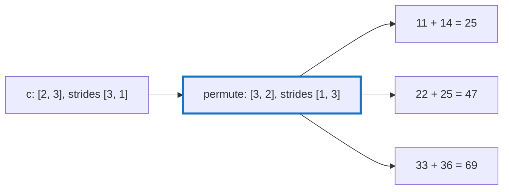

# Q-J: Why does `sum(axis)` move the summed axis to the end first?

*[Lazy graphs and views](README.md#lazy-graphs-and-views) · previous: [Q-K](q-k-stride-zero.md) · next: [Q-L](q-l-cat-slice-views.md)*

## The question

`sum(axis)` on the CPU permutes the summed axis to the end before it loops. Why does that make every output element's inputs a single run of consecutive indices?

> **Hint:** count through a tensor's elements in order, last index fastest. Which elements come next to each other?

<strong>Answer</strong>

### In short

Counting through a view in order, the last index changes fastest, so elements that differ only in the last index are neighbours. Put the summed axis last and the elements that one output sums are exactly those neighbours: output `i` adds logical indices `i·n` to `i·n + n − 1`, where `n` is the length of the summed axis. A permute is only a view, a new order of shape and strides, so nothing is copied to get there.

### An analogy

A class register sorted by surname, when you want each pupil's average mark. Re-sort it by pupil, with their marks side by side, and each average is a run along one line rather than a hunt through the whole book.

### Worked example

`c = a + b = [[11, 22, 33], [14, 25, 36]]` from [Q-K](q-k-stride-zero.md), summed over axis 0, the rows, to give one total per column.

Step                     |View                      |Logical order of elements|Runs                                            
-------------------------|--------------------------|-------------------------|------------------------------------------------
before                   |`[2, 3]`, strides `[3, 1]`|`11 22 33 14 25 36`      |column 0's inputs are at 0 and 3: not neighbours
permute axis 0 to the end|`[3, 2]`, strides `[1, 3]`|`11 14 22 25 33 36`      |`11 14`, `22 25`, `33 36`                       
sum each run             |                          |`25 47 69`               |one output per run of 2                         

### Where it shows up in tensomite

`HostDevice#reduce` permutes the reduced axis to the end and folds each output's run of `n` logical indices in order, which is also what fixes the order of additions on the CPU ([Q-H](q-h-tile-order.md)). The GPU kernels find the same runs through the view's last stride (`run_stride`).

## See also

- [Q-L](q-l-cat-slice-views.md): views used for writing, not only reading.
