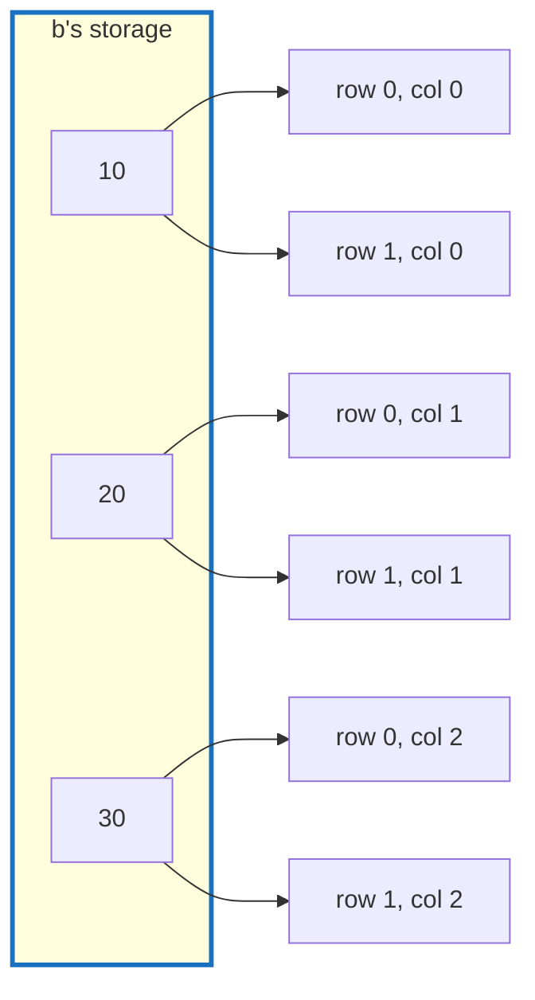

# Q-K: What does a stride of 0 mean?

*[Lazy graphs and views](README.md#lazy-graphs-and-views) · previous: [Q-A](q-a-lazy-errors.md) · next: [Q-J](q-j-reduce-axis-last.md)*

## The question

To add `a` of shape `[2, 3]` and `b` of shape `[3]`, tensomite expands `b` to `[2, 3]` without copying it. The expanded view of `b` has strides `[0, 1]`. What does the 0 mean for which element of `b` is read as you walk down the rows?

> **Hint:** a stride is how far you move in storage when one index goes up by 1.

<details>
<summary><strong>Answer</strong></summary>

### In short

A stride of 0 means "move nowhere": going down a row reads the same storage again. Element `(row, col)` of the expanded `b` is at `0 · row + 1 · col`, so the row is ignored and every row reads `10, 20, 30`. That is broadcasting with no copy.

It is easy to confuse with contiguous layout, which is the opposite case: a `[2, 3]` matrix stored row by row has strides `[3, 1]`, the rows end to end with no gap.

### An analogy

One sheet of paper under a photocopier lid with "copies: 2" set. Two rows come out; there was only ever one original.

### Worked example

View        |Shape   |Strides |Storage it reads                 
------------|--------|--------|---------------------------------
`a`         |`[2, 3]`|`[3, 1]`|`1 2 3 4 5 6`, each once         
`b`         |`[3]`   |`[1]`   |`10 20 30`                       
`b` expanded|`[2, 3]`|`[0, 1]`|`10 20 30`, then `10 20 30` again

So `c = a + b` reads, position by position:

```
(0,0): a[0] + b[0] = 1 + 10 = 11      (1,0): a[3] + b[0] = 4 + 10 = 14
(0,1): a[1] + b[1] = 2 + 20 = 22      (1,1): a[4] + b[1] = 5 + 20 = 25
(0,2): a[2] + b[2] = 3 + 30 = 33      (1,2): a[5] + b[2] = 6 + 30 = 36
```



### Where it shows up in tensomite

`View#expand` sets the stride of every broadcast dimension to 0, and `Tensor#+` expands both operands to a common shape before building the node. So kernels never see broadcasting: every binary kernel handles "two inputs of the same shape, any strides". The fan-out in the diagram also explains gradients: when `b[0]` is read twice, its gradient is the sum of both readers' (Q-Q).

</details>

## See also

- [Q-J](q-j-reduce-axis-last.md): another view trick, this time to make reductions simple.
