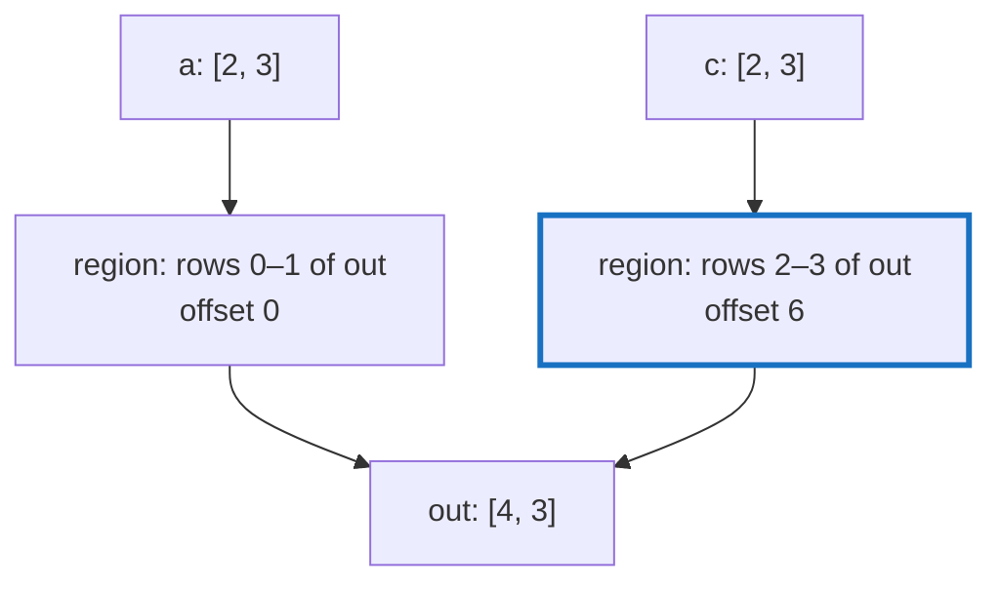

# Q-L: Why does `Cat` write each source into a slice view of the output?

*[Lazy graphs and views](README.md#lazy-graphs-and-views) · previous: [Q-J](q-j-reduce-axis-last.md) · next: [Q-M](q-m-max-start.md)*

## The question

`Tensor.cat` joins tensors along an axis. Its kernel writes each source into a slice view of the output. Why does that let it reuse the same `offset_of` indexing that every other kernel uses for reading?

> **Hint:** what is a slice of the output, as a view? What is left of `Cat` once each source has somewhere to go?

<strong>Answer</strong>

### In short

A slice of the output is a view like any other: the output's strides, with a shifted offset and a shorter shape. So "write source 2 into rows 2 to 5 of the output" becomes "copy source 2 element by element, reading through its own view and writing through the slice's view", and both positions come from `View#offset_of`. `Cat` needs no indexing of its own; it is one plain copy per source.

### An analogy

Pasting photographs into an album. Rather than measuring where each photo goes on the page, you cut a window for each photo in a template sheet laid over the page, then put each photo through its own window.

### Worked example

Join `a`, shape `[2, 3]`, and `c`, shape `[2, 3]`, along axis 0 into `out`, shape `[4, 3]`, strides `[3, 1]`.

Source|Region of `out`|Region as a view                          
------|---------------|------------------------------------------
`a`   |rows 0–1       |shape `[2, 3]`, strides `[3, 1]`, offset 0
`c`   |rows 2–3       |shape `[2, 3]`, strides `[3, 1]`, offset 6

Element `(1, 2)` of `c`, which is 36, goes to the region's `offset_of(1·3 + 2)` = `6 + 1·3 + 2·1` = 11, the last element of `out`.

### Where it shows up in tensomite

Every device does `Cat` as one copy per source into `out_view.slice(axis, start, stop)`; Metal and CUDA dispatch `copy_into_f32` once per source. `Tensor#write`, which the KV cache uses to fill one position in place, is the same idea with an existing buffer as the target.

## See also

- [Q-M](q-m-max-start.md): a reduction where the starting value matters.
