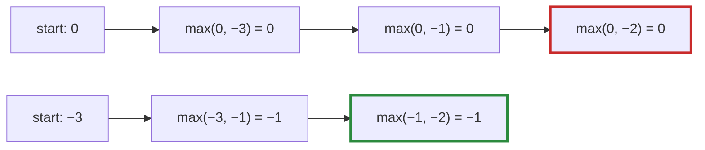

# Q-M: Why does `max` start from the first element rather than zero?

*[Lazy graphs and views](README.md#lazy-graphs-and-views) · previous: [Q-L](q-l-cat-slice-views.md) · last in the theme*

## The question

`sum` starts from 0 and adds each element. `max` starts from the first element instead, and there is a spec for exactly that. What wrong answer would starting from zero give, and for which input?

> **Hint:** a starting value must not change the answer, whatever the data. Which number is "nothing" for addition, and which is "nothing" for maximum?

<strong>Answer</strong>

### In short

Zero is the neutral value for addition (`x + 0 = x`), but not for maximum: `max(x, 0)` is 0 whenever `x` is negative. Starting `max` from zero gives 0 for any input whose elements are all negative. The neutral value for maximum is −∞; starting from the first element avoids needing one at all.

### An analogy

Finding the warmest night of a polar winter, when every night is below freezing. Write "0°" at the top of the log as a placeholder and it beats every real reading, so the warmest night reported is one that never happened.

### Worked example

Input                       |Start from 0|Start from first element
----------------------------|------------|------------------------
`[3, 1, 2]`                 |3           |3                       
`[−3, −1, −2]`              |**0**, wrong|−1                      
`[−∞, −∞, 5]` (a masked row)|5           |5                       

The second row is the spec's case. It matters in practice: attention adds a causal mask of −∞ to the scores, and softmax first subtracts each row's maximum ([Q-G](q-g-online-softmax.md)), so rows full of large negative numbers are routine.

### Where it shows up in tensomite

`HostDevice#reduce` takes an initial value: `T.zero` for `Sum`, and `nil` for `Max`, which means "start from the first input" ([Q-J](q-j-reduce-axis-last.md)). The GPU kernels' chunked maximum starts each chunk from its first element for the same reason.

## See also

- [Q-J](q-j-reduce-axis-last.md): how each output's inputs become one run.
