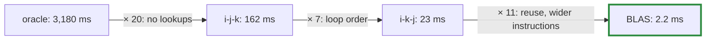

# Q-N: Why does a naive matmul lose to BLAS by thousands of times?

*[CPU speed](README.md#cpu-speed) · first in the theme · next: [Q-O](q-o-which-loop-vectorises.md)*

## The question

At 512 × 512, Accelerate on an M5 Pro does about 268 million floating-point operations in 0.26 ms. The naive kernel, tensomite's CPU oracle, takes about 5,000 times as long. SIMD, doing 4 to 8 operations per instruction, would explain at most a factor of 4 to 8. What makes up the rest of the gap?

> **Hint:** the gap is not one trick. Think about what the naive kernel spends its time on besides multiplying, and how often it fetches each number from memory.

<strong>Answer</strong>

### In short

Several factors of 5 to 20, multiplied together:

1. **Bookkeeping.** The oracle works out each element's position through its view, with an integer division per dimension, twice per multiply-add. Most of its time goes on finding numbers, not multiplying them.
2. **Loop order.** One order walks down columns, using 4 bytes of every 64-byte cache line it fetches and leaving a running sum the compiler cannot vectorise; another walks along rows, using every byte, and vectorises ([Q-O](q-o-which-loop-vectorises.md)).
3. **Reuse.** BLAS keeps a small tile of outputs in registers and copies panels of the inputs into buffers that fit the caches, so each value loaded is used many times.
4. **Wider instructions, threads and matrix units.** Fused multiply-add, wider vectors, several cores, and on Apple Silicon, I think, a matrix unit, which would explain about 1 TFLOP/s.

### An analogy

Answering a thousand questions from a library. The slowest way looks up each book's shelf in the catalogue every time (bookkeeping), fetches one book per fact from a different shelf (loop order), and puts it back before the next question (no reuse). Fix each habit and the gains multiply.

### Worked example

Measured at 512 × 512 in the Linux container, one change at a time:

Layer                                  |ms   |Gain over the row above   
---------------------------------------|-----|--------------------------
1, the oracle: view lookups per element|3,180|                          
2, plain loops over memory, order i-j-k|162  |20×                       
3, the same loops, order i-k-j         |23   |7×                        
4, OpenBLAS, one thread                |2.2  |11×                       
5, OpenBLAS, four threads              |2.1  |about 1× in this container

`20 × 7 × 11 ≈ 1,500` here. On the M5 Pro, threads on real performance cores and the matrix unit supply the rest of the 5,000×.

### Where it shows up in tensomite

The oracle keeps its cost on purpose: it is the reference every device is checked against. `BLAS` calls OpenBLAS or Accelerate for matmuls rather than competing with them. And the same layers reappear on the GPU: tiling into fast on-chip memory is to the Metal and CUDA matmuls what register and cache blocking are to BLAS (Q-X).

## See also

- [Q-O](q-o-which-loop-vectorises.md): why loop order decides whether the compiler can vectorise.
