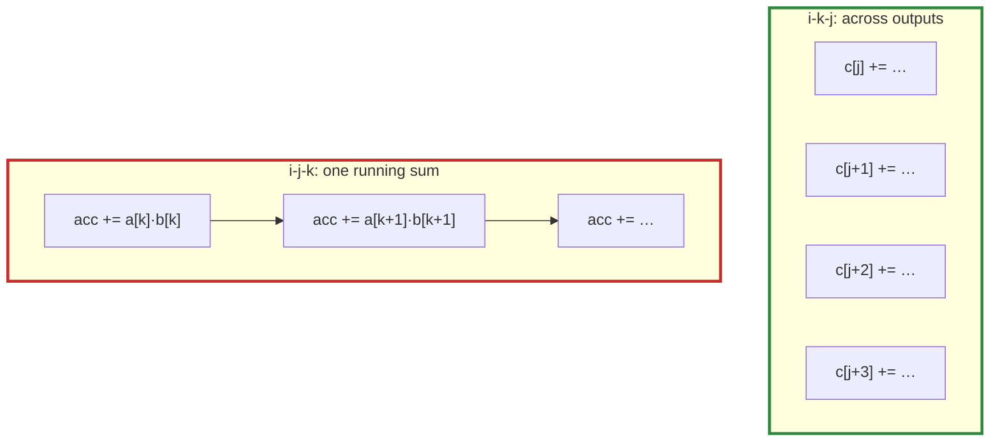

# Q-O: Why can `c[j] += a_ik × b[j]` vectorise when `acc += a[k] × b[k]` cannot?

*[CPU speed](README.md#cpu-speed) · previous: [Q-N](q-n-where-blas-speed-comes-from.md) · last in the theme*

## The question

In the i-k-j order of a matmul, the inner loop is `c[j] += a_ik × b[j]` over `j`, and the compiler vectorises it. In the i-j-k order, the inner loop is `acc += a[k] × b[k]` over `k`, and it does not. Why is one safe to vectorise and the other not?

> **Hint:** a vector instruction does four of the loop's steps at once. In each loop, does a step need the result of the step before?

<strong>Answer</strong>

### In short

In `c[j] += a_ik × b[j]`, each `j` updates a different output. Steps for `j`, `j+1`, `j+2` and `j+3` are independent, so doing them in one instruction changes nothing: each `c[j]` still receives its additions in the order of `k`, one per pass of the outer loop. In `acc += a[k] × b[k]`, every step adds to the same `acc`: a loop-carried dependency. Doing four at once means keeping four partial sums and adding them at the end, which regroups the additions and can change the bits ([Q-H](q-h-tile-order.md)). Without fast-maths flags, the compiler will not do that.

### An analogy

Four tellers serving four separate queues can all work at once. Four tellers sharing one running till cannot: each must wait for the last entry, unless they keep separate tills and add them up at closing, which rounds differently.

### Worked example

A 2 × 2 corner of the product, with `a = [[1, 2], [3, 4]]`:

Order|Inner loop                                                             |One step depends on the last? |Vectorises?               
-----|-----------------------------------------------------------------------|------------------------------|--------------------------
i-k-j|for `i = 0`, `k = 0`: `c[0][0] += 1·b[0][0]`, `c[0][1] += 1·b[0][1]`, …|no: each `j` is its own output|yes                       
i-j-k|for `i = 0`, `j = 0`: `acc += 1·b[0][0]`, then `acc += 2·b[1][0]`      |yes: one running sum          |no, not without regrouping

Each output's own sum is `c[0][0] = (0 + 1·b[0][0]) + 2·b[1][0]` in both orders, so the two give the same bits; only the i-k-j order lets the compiler run four outputs side by side.

### Where it shows up in tensomite

The same split, independent work at once and dependent sums in order, recurs throughout: softmax's `exp` pass vectorises while its sum stays in order ([Q-T](q-t-softmax-two-passes.md)); GPU kernels give each thread its own outputs rather than splitting one sum ([Q-AR](q-ar-splitting-a-sum.md)); and Metal's `Unview` loads ahead in parallel but adds in order ([Q-AS](q-as-loading-ahead.md)).

## See also

- [Q-T](q-t-softmax-two-passes.md): the same idea in softmax.
