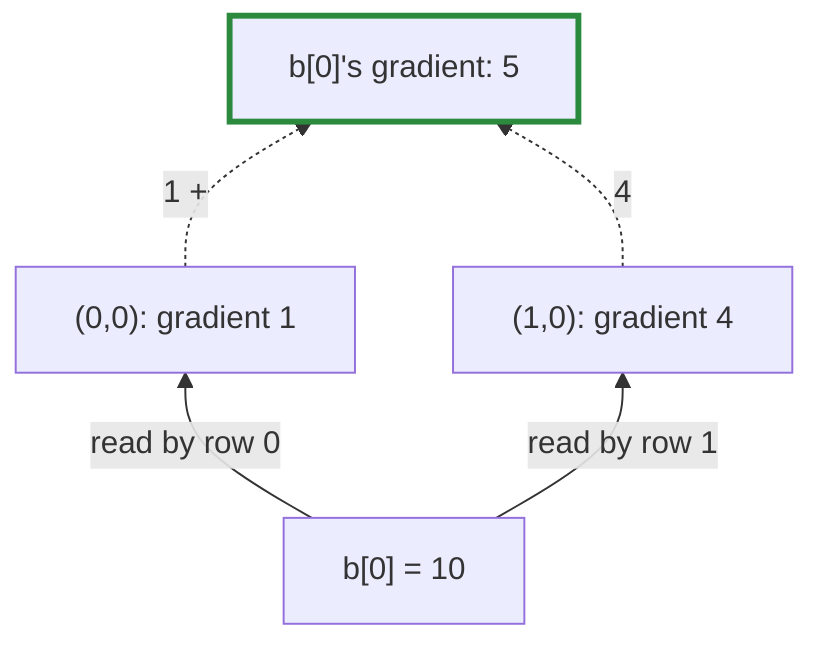

# Q-Q: What is the gradient of a tensor that was broadcast?

*[Autograd](README.md#autograd) · first in the theme · next: [Q-W](q-w-gradient-node-of-an-expand.md)*

## The question

A tensor `x` of shape `[3]` is expanded to `[2, 3]` (a stride-0 view, [Q-K](q-k-stride-zero.md)). The gradient arriving at the expanded view is `[[1, 2, 3], [4, 5, 6]]`. What is the gradient of `x`?

> **Hint:** a gradient is a sensitivity: nudge `x[0]` by a tiny ε and ask how much the loss moves. How many places in the expanded view does `x[0]` appear in?

<strong>Answer</strong>

### In short

`[5, 7, 9]`. Each element of `x` is read once per row, so nudging `x[0]` by ε moves both `(0, 0)` and `(1, 0)` of the expanded view by ε. The loss moves by `1·ε + 4·ε = 5ε`, so `∂loss/∂x[0] = 5`. In general, a broadcast value's gradient is the sum of the gradients at every place it was copied to: a sum down each column here.

### An analogy

One sheet of paper photocopied twice ([Q-K](q-k-stride-zero.md)). If each copy earns a fee, the original's worth is the sum of its copies' fees.

### Worked example

The bias `b = [10, 20, 30]` of this FAQ's running example, in `loss = ((a + b) · w).sum` with `w = [[1, 2, 3], [4, 5, 6]]`. The gradient arriving at `a + b`, and so at the expanded `b`, is `w` itself:

Column|Gradients at the expanded view|Sum, `b`'s gradient
------|------------------------------|-------------------
0     |1, 4                          |5                  
1     |2, 5                          |7                  
2     |3, 6                          |9                  

Tensomite agrees: `Tensomite.grad(loss, [b])` gives `[5, 7, 9]`.

### Where it shows up in tensomite

There is no "broadcast" op with its own gradient rule: broadcasting is a view, and every view shares one backward rule, `Unview` ([Q-W](q-w-gradient-node-of-an-expand.md)). It sends each gradient element back to the position it was read from and adds where several land in the same place; stride 0 is exactly the case where several do.

## See also

- [Q-W](q-w-gradient-node-of-an-expand.md): what that rule looks like in the gradient's graph.
