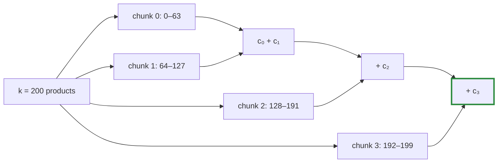

# Q-R: Why must split-K's split depend only on `k`?

*[Order of addition and determinism](README.md#order-of-addition-and-determinism) · previous: [Q-I](q-i-exact-prefill-decode.md) · next: [Q-Z](q-z-modules-match-exactly.md)*

## The question

A matrix product `[m, k] · [k, n]` sums `k` products for each output. Split-K cuts that sum into chunks, one per thread, and adds the chunk sums at the end. Why must the way it is cut depend only on `k`, and not on the number of rows `m`, for prefill to equal decode?

> **Hint:** in prefill a token's row is one of many; in decode it is the only one. What would a split chosen by row count do to that row's sum?

<strong>Answer</strong>

### In short

A token's output is the same sum of `k` products whether it is computed as one row of 20 (prefill) or alone (decode). If the split depended on `m`, the two would cut that sum differently, group the additions differently, and give different bits ([Q-H](q-h-tile-order.md)). Fixing the chunks to 64 elements of `k`, added in chunk order, makes the grouping a property of `k` alone, which prefill and decode share.

### An analogy

Counting a jar of coins in piles of 64, then adding the piles from left to right. However many jars are on the table, each jar is counted the same way, so each jar's total is the same.

### Worked example

For `k = 200`, the chunks are always elements 0–63, 64–127, 128–191 and 192–199, and the output is `((c₀ + c₁) + c₂) + c₃`.

Rows             |A split by row count (wrong)                   |Split by `k` (tensomite)
-----------------|-----------------------------------------------|------------------------
prefill, `m = 20`|many rows keep the GPU busy, so 2 chunks of 100|4 chunks of 64          
decode, `m = 1`  |one row leaves it idle, so 8 chunks of 25      |4 chunks of 64          

The first column groups the same 200 products two ways, so prefill and decode could differ; the second groups them one way.

### Where it shows up in tensomite

`CHUNK` is 64 in both GPU backends. `Split`, `Tiled`, `TwoPass` and `TiledTwoPass` all compute the same chunk sums and add them in chunk order, so `Auto` can pick between them by shape for speed alone. That is what lets a 20-row prefill use `Tiled` while a 1-row decode uses `Split` or `TwoPass`.

## See also

- [Q-AT](q-at-chunk-sums.md): the same chunks, written out by a kernel that splits `k` across blocks.
