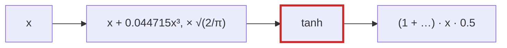

# Q-S: Why can a fused CPU `gelu` match bit for bit, but a fused Metal `gelu` not?

*[Order of addition and determinism](README.md#order-of-addition-and-determinism) · previous: [Q-AG](q-ag-fused-multiply-add.md) · next: [Q-I](q-i-exact-prefill-decode.md)*

## The question

A fused `gelu` computes `0.5x(1 + tanh(√(2/π)(x + 0.044715x³)))` in one loop instead of eight separate ops. Why can the fused CPU version be checked bit for bit against the eight-op composite, while the fused Metal version needs a tolerance?

> **Hint:** list the operations in the formula. Which of them does the hardware do itself, and which come from a maths library?

<strong>Answer</strong>

### In short

Two computations give the same bits when they do the same operations, in the same order, with the same rounding. The fused CPU loop does exactly the composite's operations, rounding each to float32, with no FMA ([Q-AG](q-ag-fused-multiply-add.md)), so it matches. On Metal, `+`, `−` and `×` are correctly rounded and so match too, but `tanh` comes from the GPU's maths library, which approximates it differently from the CPU's. One line of the bill differs, and the difference carries through.

### An analogy

Two cashiers ring up the same items in the same order and round after every line, so their totals match to the cent. Then one item has no price tag, and each cashier estimates it from a different price list. Everything after that line can differ.

### Worked example

Operation in `gelu`                         |CPU against CPU composite              |Metal against CPU composite
--------------------------------------------|---------------------------------------|---------------------------
`x · x · x`, `· 0.044715`, `+ x`, `· √(2/π)`|identical: correctly rounded everywhere|identical                  
`tanh(…)`                                   |identical: same library                |may differ in the last bit 
`+ 1`, `· x`, `· 0.5`                       |identical                              |carry the `tanh` difference

### Where it shows up in tensomite

`spec/gpu_spec.cr` sorts ops into three lists. `EXACT` holds ops whose GPU results must equal the CPU's bit for bit; `SPLIT` holds long sums and matmuls, which add in the GPU's own fixed chunks and so match the CPU only closely; `CLOSE` holds those that use `exp`, `log`, `tanh` or `sqrt`, compared within a tolerance. The kernel macros emit one operation per statement, so a Metal compiler cannot merge two into an FMA: a fused Metal `gelu` still matches an unfused Metal `gelu` exactly.

## See also

- [Q-I](q-i-exact-prefill-decode.md): where exact matching is required, and why a tolerance would hide bugs.
