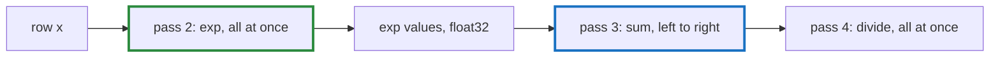

# Q-T: Why can softmax's `exp` pass vectorise and still keep the composite's bits?

*[Fusion and kernels](README.md#fusion-and-kernels) · previous: [Q-G](q-g-online-softmax.md) · last in the theme*

## The question

The CPU's fused softmax adds its `exp` values in a strict left-to-right order, to keep the composite's bits: a float sum cannot be reordered ([Q-H](q-h-tile-order.md)). Yet it writes all the `exp` values first, in one pass, and sums them in a second. Why does that let the `exp` pass vectorise, and why are the bits still identical?

> **Hint:** which pass has a loop-carried dependency, where each step needs the one before?

<strong>Answer</strong>

### In short

Each `exp(xⱼ − m)` depends only on its own element, so the `exp` pass has no dependency between steps and the compiler can compute four or eight at once. The sum is the pass with the dependency, each step adding to the last, so it stays in strict order, one element at a time. The values are the same either way: each `exp` is rounded to float32 when stored, exactly as the composite stores its `exp` tensor before its `sum` op reads it. Same values, summed in the same order, give the same bits.

Fused into one loop, `total += exp(xⱼ − m)` would chain each `exp` to the previous addition, and the compiler could not vectorise the `exp` without reordering the sum.

### An analogy

Weighing a basket of parcels and logging a running total. Several people can weigh parcels at once, writing each weight on its label; one clerk then adds up the labels in order. The weighing goes faster, and the total is the one the clerk alone would have reached.

### Worked example

The row `[1, 2, 3, 4]` from [Q-G](q-g-online-softmax.md), with `m = 4`:

Pass      |Work                                       |Dependency                      |Vectorises?   
----------|-------------------------------------------|--------------------------------|--------------
1, maximum|`m = 4`                                    |each step compares with the last|no            
2, `exp`  |`e⁻³, e⁻², e⁻¹, e⁰`, each stored as float32|none: each element on its own   |yes           
3, sum    |`(((0 + e⁻³) + e⁻²) + e⁻¹) + e⁰`           |each step adds to the last      |no: order kept
4, divide |`eⱼ / 1.553`                               |none                            |yes           

### Where it shows up in tensomite

`HostDevice#rows` does exactly these passes for `Op::Softmax`: a loop writing `Maths.exp(row_in[j] - top)` into the output row, then `total += row_out[j]` in order, then a division. Tensomite's own `exp`, rather than the C library's, is what lets the second pass vectorise, since a call into libm cannot be vectorised.

## See also

- [Q-O](q-o-which-loop-vectorises.md): loop-carried dependencies in matmul, in the CPU speed theme.
- [Q-AS](q-as-loading-ahead.md): the same split, loads ahead and additions in order, on a GPU.
