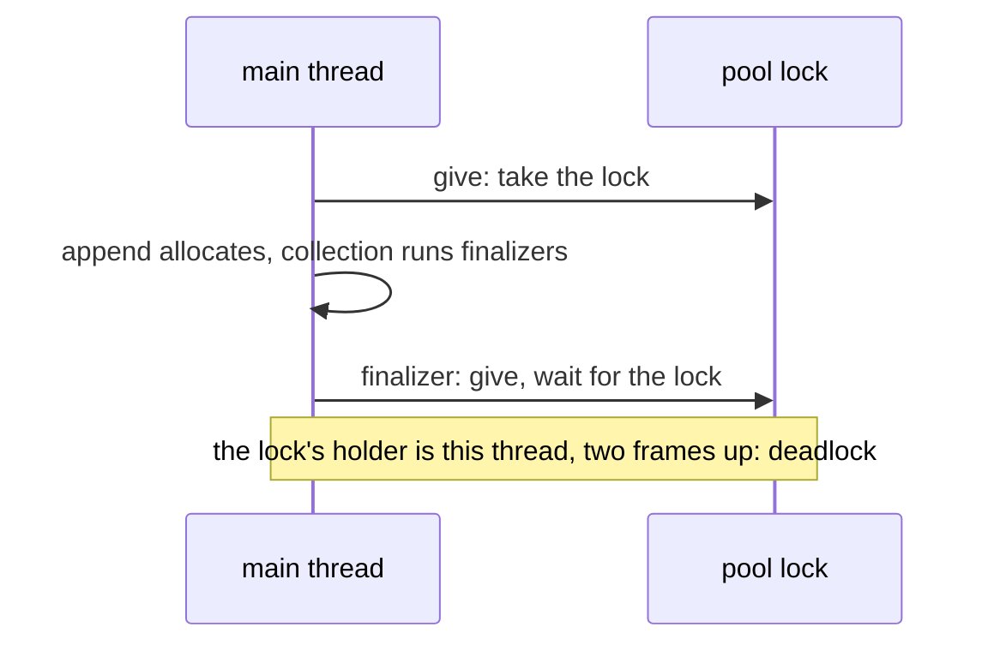

# Q-U: Why can't a finalizer wait for a lock, like ordinary threaded code?

*[GPU runtime and lifetimes](README.md#gpu-runtime-and-lifetimes) · first in the theme · next: [Q-V](q-v-encoded-is-not-executed.md)*

## The question

When a tensor is garbage-collected, its buffer's finalizer gives the memory back to the device's buffer pool, which a lock protects. Ordinary threaded code waits for a lock that is taken. Why must a finalizer never wait for this one?

> **Hint:** a finalizer runs during a collection, and a collection can start inside any allocation. Which thread might already be holding the lock?

<strong>Answer</strong>

### In short

The thread holding the lock may be the finalizer's own. A thread inside the pool's code, holding the lock, allocates memory; the allocation starts a collection; the collection runs finalizers right there, on that thread, mid-operation. If one of them waits for the lock, it waits for the outer call on its own stack, which cannot continue until the finalizer returns. The thread waits for itself, forever. If another thread held the lock, waiting would be fine, but a finalizer cannot tell which case it is in. So the rule is never to wait: try the lock once, and if it is busy, do something that needs no lock.

### An analogy

You are on the phone and put the caller on hold to answer the door. The visitor wants to use the phone and waits for you to finish the call. The call cannot finish until you come back from the door.

### Worked example

The bias `b = [10, 20, 30]`'s buffer, collected at the wrong moment:

Step|On the main thread                                                   
----|---------------------------------------------------------------------
1   |the pool's `give` takes the lock and appends to a free list          
2   |the append grows the list, which allocates                           
3   |the allocation starts a collection                                   
4   |the collection finalizes `b`'s old buffer: its finalizer calls `give`
5   |`give` finds the lock taken, by step 1, which is waiting on step 4   

### Where it shows up in tensomite

`BufferPool`'s lock is an atomic try-lock that never waits: a busy pool means a request allocates fresh memory, and memory being returned is freed. `RetiredList`, which takes back GPU buffers from finalizers, goes further and never allocates at all: it fills one of two fixed arrays and swaps them. An earlier version appended to a growable array, so a finalizer's allocation ran other finalizers inside it, and nearly every GPU buffer was freed instead of pooled (Decision BG).

## See also

- [Q-V](q-v-encoded-is-not-executed.md): when a GPU buffer may safely go back to the pool at all.
