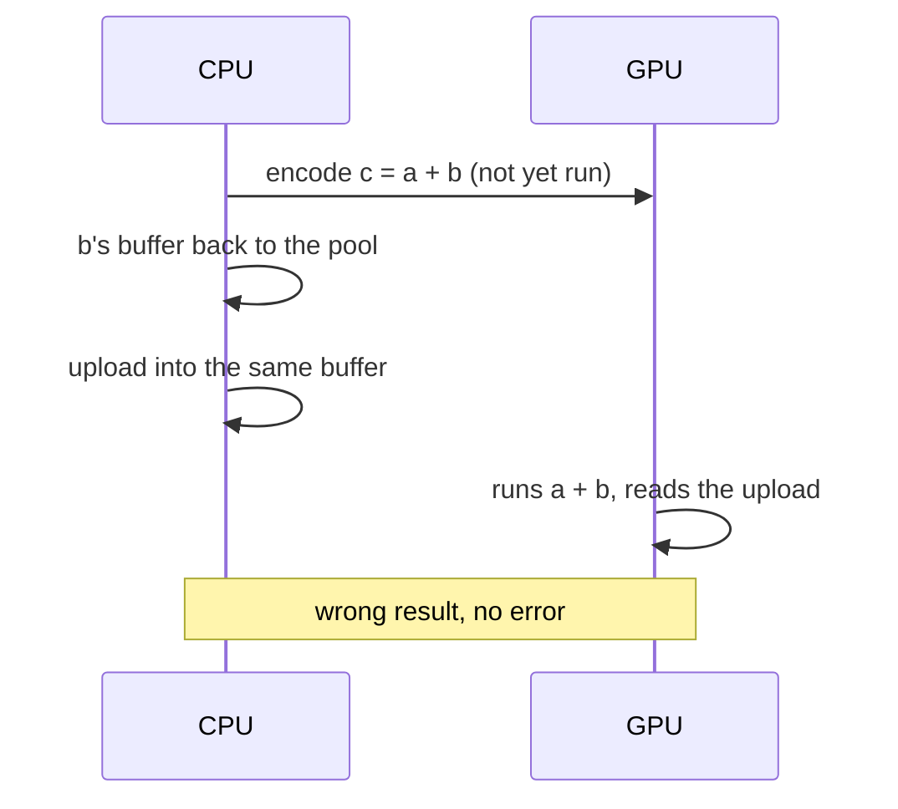

# Q-V: When is it unsafe on Metal, but not on the CPU, to reuse a buffer whose last consumer has run?

*[GPU runtime and lifetimes](README.md#gpu-runtime-and-lifetimes) · previous: [Q-U](q-u-finalizer-and-lock.md) · next: [Q-AH](q-ah-v2-symbols.md)*

## The question

A planned scheduler could return a node's buffer to the pool as soon as the node's last consumer has run (Decision AA). On the CPU that is safe. Under what condition is it unsafe on Metal, even though Apple Silicon's memory is shared, so there is only one copy?

> **Hint:** the question is not where the data is, but when the consumer actually reads it.

<strong>Answer</strong>

### In short

On the CPU, "the consumer has run" means it has finished: the kernel ran synchronously. On Metal, it means the consumer has been encoded into a command buffer, which the GPU executes later, perhaps milliseconds afterwards. If the buffer goes back to the pool at encoding time, the next allocation can take it and the CPU can write into it at once, by an upload or a host kernel, while the GPU has yet to read the old contents. The GPU then reads the new data and computes a wrong result, with no error. Metal orders GPU commands against each other, so a later GPU write would wait its turn; the hazard is the CPU writing now while the GPU reads later.

### An analogy

Handing a hotel room to the next guest because the previous one has booked their checkout, while their luggage is still upstairs.

### Worked example

Time|CPU                                                          |GPU                                          
----|-------------------------------------------------------------|---------------------------------------------
1   |encodes `c = a + b`; `b`'s buffer has no more consumers      |idle, or busy with earlier work              
2   |returns `b`'s buffer to the pool                             |                                             
3   |allocates a buffer for an upload: gets `b`'s; writes new data|                                             
4   |                                                             |executes `a + b`, reading the new data: wrong

### Where it shows up in tensomite

Metal's `retire` and `recycle_retired` move freed buffers into the pool only when no GPU work is pending (after `flush` has waited), so a pooled buffer is never one the GPU might still read. Decision AA, planned release of intermediates, would need the same rule: release after the consumer completes, not after it is encoded.

## See also

- [Q-AI](q-ai-asynchronous-errors.md): the same gap between queuing work and running it, seen in an error.
