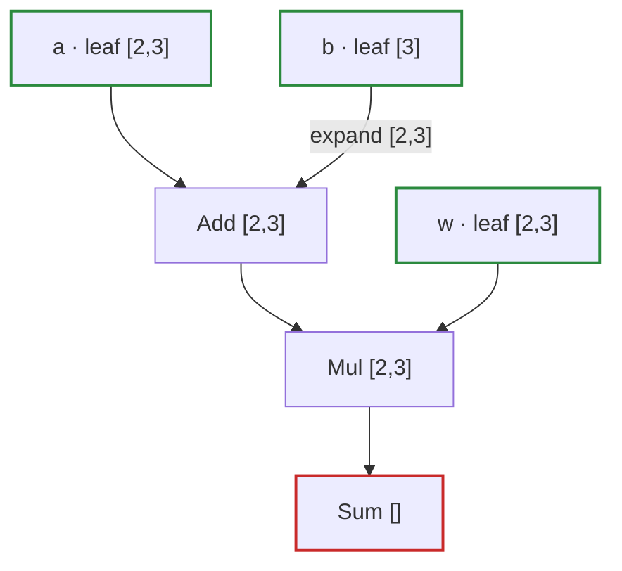
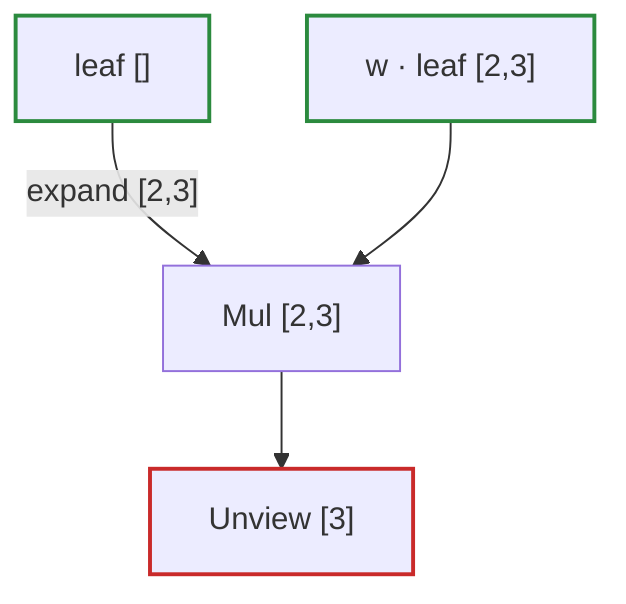

# Q-W: What does a broadcast tensor's gradient look like in the graph?

*[Autograd](README.md#autograd) · previous: [Q-Q](q-q-gradient-of-a-broadcast.md) · last in the theme*

## The question

In the graph of `loss = ((a + b) · w).sum`, `b` reaches `Add` through an `expand` edge: a view, not an op. `Tensomite.grad(loss, [b])` builds a new graph, the backward pass, made of ordinary ops. What node will `b`'s gradient be, and what does it do?

> **Hint:** from [Q-Q](q-q-gradient-of-a-broadcast.md), the gradient arriving at the expanded `b` is `[2, 3]`, and `b` is `[3]`. Something must turn one into the other.

<strong>Answer</strong>

### In short

An `Unview` node of shape `[3]`. `grad` walks back from the loss applying each op's chain rule. `Add` passes its gradient straight through, so the `[2, 3]` gradient reaches the `expand` edge unchanged. A view's adjoint is `Unview`: it inverts the view, sending each element back to the storage position it was read from and adding where several land together. For an expand from `[3]`, that sums the `[2, 3]` gradient down its columns into `[3]`.

### An analogy

Delivery receipts traced back to the warehouse shelf each parcel left from. Two parcels from the same shelf put two receipts on that shelf's tally.

### Worked example

The forward graph, as `loss.to_mermaid` draws it, with the view on the edge:

And `Tensomite.grad(loss, [b]).first.to_mermaid`, the backward graph:

Reading it from the top:

Node                           |What it is                                         |Value                   
-------------------------------|---------------------------------------------------|------------------------
`leaf []`, expanded to `[2, 3]`|the loss's own gradient, 1, broadcast through `Sum`|all ones                
`Mul [2, 3]`                   |`Mul`'s rule for `a + b`: the gradient times `w`   |`[[1, 2, 3], [4, 5, 6]]`
(no node)                      |`Add`'s rule: pass the gradient through            |unchanged               
`Unview [3]`                   |the adjoint of `expand [2, 3]`                     |`[5, 7, 9]`             

The seed's own `expand` is the same trick in reverse: `Sum`'s gradient broadcasts a scalar back over the summed shape.

### Where it shows up in tensomite

`Op::Unview` is a primitive on every device. On the GPUs it is the kernel that [Q-AR](q-ar-splitting-a-sum.md) and Q-AS are about: `Unview [192]`, the gradient of a layer norm's weight, is this same column sum over 2,048 rows, and was for a while the slowest op of a training step.

## See also

- [Q-AR](q-ar-splitting-a-sum.md): why that column sum is not split across threads.
