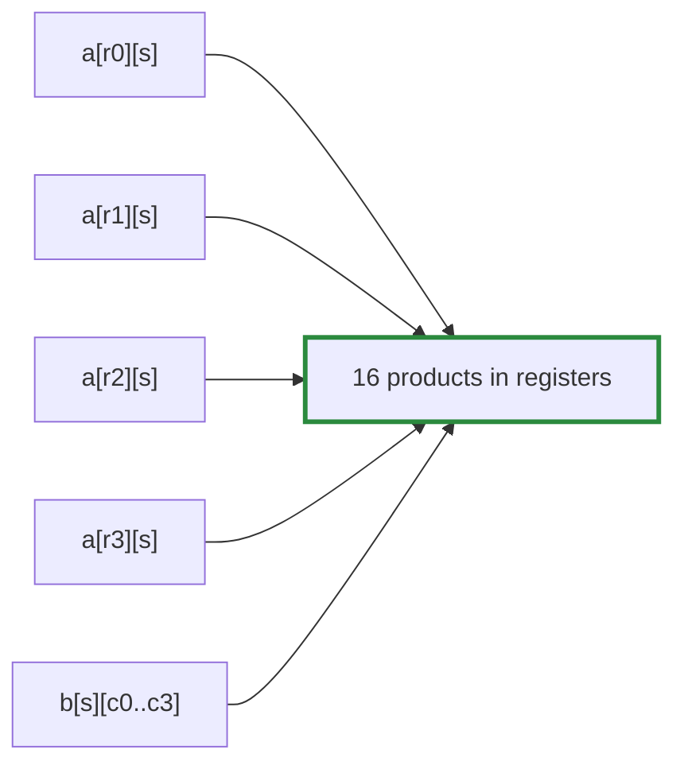

# Q-X: Why does a 4 × 4 patch of outputs per thread cut memory reads?

*[GPU speed](README.md#gpu-speed) · first in the theme · next: [Q-AL](q-al-storing-the-head-transposed.md)*

## The question

The tiled matmul gives each thread a 4 × 4 patch of outputs rather than one output. Forget the shared threadgroup memory for a moment: why does the patch alone already cut reads from memory? How many times is each value of `a` the thread loads used?

> **Hint:** for one step along `k`, list what a one-output thread loads and what a 4 × 4 thread loads, and count the multiply-adds each does.

<strong>Answer</strong>

### In short

At each step along `k`, a thread computing one output loads one value of `a` and one of `b` for a single multiply-add: two loads per multiply-add. A thread computing a 4 × 4 patch loads 4 values of `a` (one per row of its patch) and 4 of `b` (one per column), keeps them in registers, and does all 16 multiply-adds between them. Each `a` value is used 4 times, each `b` value 4 times: 8 loads for 16 multiply-adds, a quarter of the traffic per output. It is the register blocking of BLAS ([Q-N](q-n-where-blas-speed-comes-from.md)) on a GPU.

### An analogy

Making sandwiches for a table of 16, one at a time, fetching bread and filling for each. Lay out 4 breads and 4 fillings and make every combination: 8 trips to the larder instead of 32.

### Worked example

One step along `k`:

Thread computes|Loads from memory |Multiply-adds|Loads per multiply-add
---------------|------------------|-------------|----------------------
1 output       |1 of `a`, 1 of `b`|1            |2                     
a 4 × 4 patch  |4 of `a`, 4 of `b`|16           |0.5                   

### The catch

Patches need enough outputs to go round. A `128 × 768` output is only 24 blocks of 64 × 64, too few to fill the GPU; that is what `TiledTwoPass` later fixed for weight gradients, by splitting `k` as well ([Q-AT](q-at-chunk-sums.md)).

### Where it shows up in tensomite

`matmul_tiled<BM, BN, BK, TM, TN>` on Metal and CUDA, with `TM = TN = 4`; threadgroup memory then shares each tile among the block's threads, so each element is read from main memory once per block.

## See also

- [Q-AN](q-an-which-way-the-weights-run.md): when the order of reads matters more than their number.
