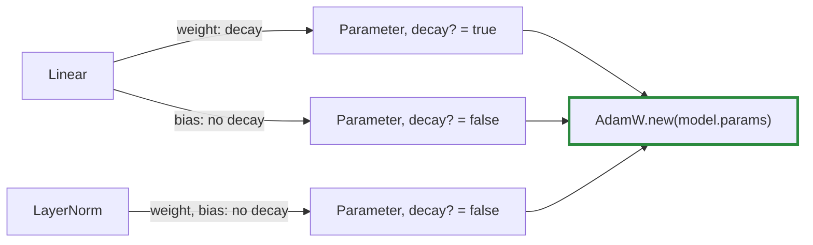

# Q-Y: How do named parameters simplify AdamW's decayed and undecayed split?

*[Modules](README.md#modules) · first in the theme · next: [Q-AA](q-aa-what-a-macro-buys.md)*

## The question

AdamW decays weight matrices and embeddings towards zero, but not layer norms or biases. The Shakespeare trainer once kept its parameters in plain arrays, so the split was bookkeeping by position. If parameters are registered by name, such as `h.0.attn.c_attn.weight`, how does that simplify the split?

> **Hint:** what does a parameter's name tell you about the part it belongs to?

<strong>Answer</strong>

### In short

With names, the split becomes a rule about the parameter rather than a list kept in step with the model: anything under a norm (`ln_*`) or named `bias` is not decayed, everything else is. Add a layer and the rule still holds; nobody edits two lists.

Tensomite goes one step further. The knowledge sits where the parameter is made: `LayerNorm` creates its weight and bias with `decay: false`, and `Linear` its bias, so every `Parameter` carries a `decay?` flag. The trainer passes `model.params` to `AdamW` and reads nothing else.

### An analogy

Sorting a warehouse for an inventory tax that applies to some goods. By position: "shelves 3, 7 and 12 are exempt", correct until someone rearranges. By label: "anything marked *perishable* is exempt", which survives any rearranging. Better still, the supplier prints the tax status on each box.

### Worked example

The tiny GPT-2's first block, as `named_params` lists it:

Name                              |Shape      |`decay?`
----------------------------------|-----------|--------
`wte.weight`                      |`[400, 32]`|yes     
`h.0.ln_1.weight`, `h.0.ln_1.bias`|`[32]`     |no      
`h.0.attn.c_attn.weight`          |`[32, 96]` |yes     
`h.0.attn.c_attn.bias`            |`[96]`     |no      
`h.0.mlp.c_fc.weight`             |`[32, 128]`|yes     
`h.0.mlp.c_fc.bias`               |`[128]`    |no      
`ln_f.weight`, `ln_f.bias`        |`[32]`     |no      

### Where it shows up in tensomite

`Parameter#decay?` (Decision AI) and `AdamW`'s `decays?`; `Module#named_params` gives the names, which `save`, `load` and diagrams use.

## See also

- [Q-AC](q-ac-stored-attention-mask.md): names that match a file you did not write.
