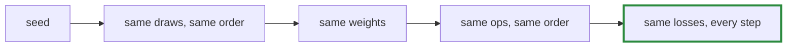

# Q-Z: Why should a refactor match exactly rather than roughly?

*[Order of addition and determinism](README.md#order-of-addition-and-determinism) · previous: [Q-R](q-r-split-depends-on-k.md) · next: [Q-AR](q-ar-splitting-a-sum.md)*

## The question

The Shakespeare model was rewritten on `Tensomite::Module`s (M7b). On the same machine, why should the new code give the same losses as the old at every step, digit for digit, rather than merely similar ones?

> **Hint:** list what decides a loss: the operations, their order, and something random.

<details>
<summary><strong>Answer</strong></summary>

### In short

The modules build the same operations, in the same order, from the same weights, which are drawn from the same random generator in the same sequence. Same inputs and same operations in the same order give the same bits ([Q-H](q-h-tile-order.md)), and so the same losses. A difference, however small, means one of those four things changed, and that is a bug to find.

### An analogy

Rearranging a kitchen should not change the cake. If the cake tastes slightly different, something besides the furniture moved: an ingredient, a step, the order.

### Worked example

The two runs are compared line by line:

```
git checkout main && crystal run --release examples/shakespeare.cr > main.txt
git checkout branch && crystal run --release examples/shakespeare.cr > branch.txt
diff <(grep loss main.txt) <(grep loss branch.txt)
```

An empty diff is the pass. A diff that starts at step 0 points at initialisation, such as weights drawn in another order. One that starts later points at an operation, such as a regrouped sum.



### Where it shows up in tensomite

The same test has caught or confirmed every change since: the losses printed by the trainer were compared step for step through each GPU speed change (Decisions BG to BK). `spec/builder_spec.cr` keeps plain-module copies of the tutorial and Shakespeare models and checks that the `Builder` versions give their exact losses.

</details>

## See also

- [Q-AR](q-ar-splitting-a-sum.md): a speed-up that would have failed this test, and the one that passed it.
